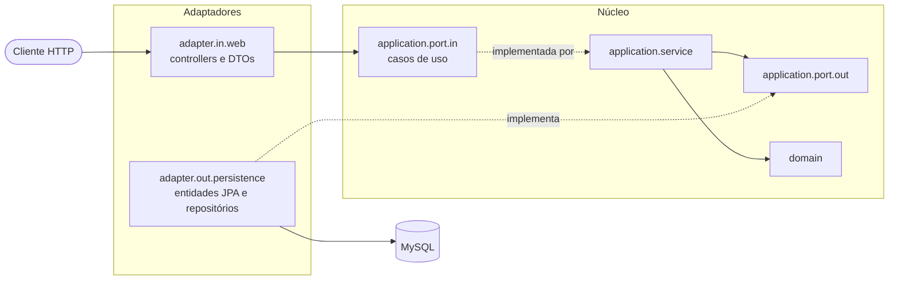
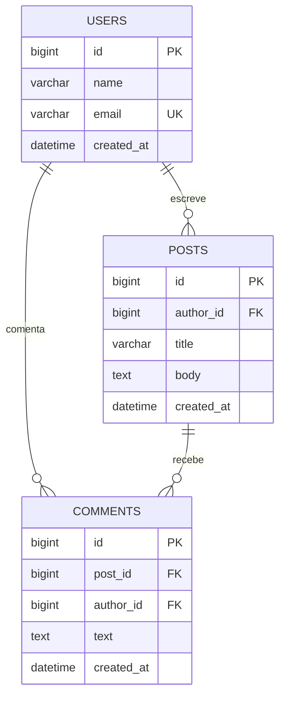

# API de Posts e Usuários

API REST de uma mini rede social (usuários, posts e comentários) com Spring Boot e MySQL, organizada em arquitetura hexagonal.

Usuários criam posts e comentam posts de outros usuários. A API tem CRUD de usuários, criação e consulta de posts com comentários, listagens paginadas, duas buscas e um ranking de autores. A documentação interativa (Swagger UI) sobe junto com a aplicação.

## Tecnologias
- Java 21, Spring Boot 4.1
- Spring Web MVC, Spring Data JPA, Hibernate
- MySQL 8 (Docker), Flyway
- Bean Validation, Maven
- springdoc-openapi 3.2.0 (OpenAPI e Swagger UI)
- Testes: JUnit 5, Mockito, Testcontainers (MySQL), ArchUnit

> Desvio consciente: a série 3.0.x do springdoc foi compilada contra o Boot 4.0.x. Usei a 3.2.0, compilada contra o Boot 4.1.x, e ela funciona com o Boot 4.1.1 do projeto (há teste de fumaça em `OpenApiTest`).

## Como rodar
Pré-requisitos: JDK 21 ou superior, Docker Desktop e Git.

1. Clone o repositório e entre na pasta.
2. Crie o arquivo de variáveis a partir do modelo:
   ```
   copy .env.example .env
   ```
   Abra o `.env` e preencha `DB_ROOT_PASSWORD` e `DB_PASSWORD`. Use letras e números, sem `$ # = "`. O `.env` nunca vai para o Git.
3. Suba o MySQL (porta `3308`):
   ```
   docker compose up -d --wait
   ```
4. Rode a aplicação:
   ```
   .\mvnw.cmd spring-boot:run
   ```
5. Abra a documentação interativa: http://localhost:8080/swagger-ui.html (o JSON do OpenAPI fica em http://localhost:8080/v3/api-docs).
6. Para os testes, veja a seção [Testes](#testes) (só precisam do Docker aberto):
   ```
   .\mvnw.cmd test
   ```

## Arquitetura
Hexagonal: o núcleo não conhece frameworks, e o que é específico de JPA fica no adaptador de persistência.

```
com.modestoneto.posts
 ├─ domain               modelos e exceções, sem Spring ou JPA
 ├─ application          portas (in/out), serviços e tipos de paginação próprios
 ├─ adapter
 │   ├─ in.web           controllers, DTOs e tratamento de erros
 │   └─ out.persistence  entidades JPA, repositórios e adaptadores
 └─ config
```



As dependências apontam para dentro: o núcleo (`domain` e `application`) não conhece Spring Data, JPA, Jackson nem Swagger, e `adapter.in` e `adapter.out` não se conhecem. Os testes de arquitetura (ArchUnit) falham se alguém quebrar essas regras.

## Modelo de dados


## Origem e créditos
Projeto de estudo baseado no curso "Java COMPLETO" (Udemy). O curso usa arquitetura em camadas; aqui o domínio e os casos de uso são os mesmos, mas a estrutura foi **adaptada para arquitetura hexagonal**. Esta é, portanto, uma versão adaptada, não uma cópia do projeto original.

## Decisões de persistência
- `@ManyToOne(fetch = LAZY)` em todas as associações, com `spring.jpa.open-in-view=false`: a entidade JPA nunca sai do adaptador. O mapper converte para o domínio dentro da transação.
- `getReferenceById` para ligar post e comentário ao autor sem `SELECT` extra (o serviço já validou que o autor existe).
- Comentários em `Post` com `cascade = ALL` e `orphanRemoval = true`: o domínio é imutável e o `save` faz `merge` da lista inteira.

## N+1: antes e depois
Listagem de 6 posts com 13 comentários e seus autores, medida pelo log SQL do Hibernate:

| | Queries por listagem |
|---|---|
| Antes (listagem padrão, tudo LAZY) | **10** (1 de posts + 6 de comentários + 3 de autores) |
| Depois (`@EntityGraph` com `author`, `comments`, `comments.author`) | **1** |

Evidência: log SQL do Hibernate (`org.hibernate.SQL=DEBUG`) da listagem sem fetch, extraído do teste de controle `contadorDeConsultasDetectaN1QuandoNaoHaEntityGraph` (colunas abreviadas):

```
select ... from posts                                         -- 1 consulta de posts
select ... from comments where post_id=? order by ...         -- repetida 6 vezes, uma por post
select ... from users where id=?                              -- repetida 3 vezes, uma por autor
```

Depois, com `@EntityGraph`, a mesma leitura vira uma única consulta: `select ... from posts ... left join comments ... left join users ...`.

A correção fica no repositório do adaptador, sem tocar no domínio.

## Endpoints
| Método | Rota | Resposta |
|---|---|---|
| GET | `/users?page=&size=&sort=` | 200, página de usuários (`sort`: `name` ou `createdAt`, padrão `createdAt,desc`; `size` de 1 a 100), ou 400 |
| GET | `/users/{id}` | 200, ou 404 |
| POST | `/users` | 201, ou 400 (validação) e 409 (e-mail repetido) |
| PUT | `/users/{id}` | 200, ou 404 e 409 |
| DELETE | `/users/{id}` | 204, ou 404 e 409 (usuário com posts ou comentários) |
| POST | `/posts` | 201 com `Location`, ou 400 e 404 (autor inexistente) |
| GET | `/users/{id}/posts?page=&size=&sort=` | 200, página de posts com comentários (`sort`: `title` ou `createdAt`), ou 400 e 404 |
| GET | `/users/ranking?limit=` | 200, autores por número de posts (`limit` de 1 a 100, padrão 10; inclui quem tem 0), ou 400 |
| GET | `/posts/{id}` | 200 com autor e comentários, ou 404 |
| GET | `/posts/search/title?title=&page=&size=&sort=` | 200, página de posts cujo título contém o texto, ou 400 (título em branco ou ausente) |
| GET | `/posts/search?text=&minDate=&maxDate=&page=&size=&sort=` | 200, página de posts; todos os filtros são opcionais, ou 400 (data inválida, `minDate` > `maxDate`) |
| POST | `/posts/{id}/comments` | 201 com o post inteiro, ou 400 e 404 (post ou autor inexistente) |

Erros seguem o formato `{timestamp, status, error, message, path}`.

## Paginação com coleção
`GET /users/{id}/posts` pagina posts que carregam comentários. A preocupação clássica é que `JOIN FETCH` de coleção com `Pageable` faça o Hibernate paginar **em memória** (aviso `HHH90003004`). Foi testado nesta versão (Hibernate 7.4.5) e **não acontece**: o `LIMIT` vai para uma subconsulta sobre `posts` e os comentários entram por `LEFT JOIN`, e cada página traz o post com todos os comentários. Por isso o `@EntityGraph` basta, sem a técnica de duas consultas.

| Página de 2 posts e 5 comentários | Queries |
|---|---|
| Sem fetch (tudo LAZY) | **7** |
| `@EntityGraph(author, comments, comments.author)` | **2** (usuário + posts com joins) |

Em versões anteriores do Hibernate o comportamento pode ser outro. Vale repetir a verificação no log ao atualizar.

## Buscas: JPQL e SQL nativo
- **Por título:** query method do Spring Data (`findByTitleContainingIgnoreCase`). O Spring escapa `%` e `_`, então o texto do usuário é sempre literal.
- **Busca completa (JPQL):** o texto vale para título, corpo ou comentários, com intervalo de datas. Os comentários entram por `EXISTS` e não por `JOIN`: o `JOIN` repetiria o post que tem vários comentários batendo e quebraria o total da paginação. Parâmetros nulos com `(:p is null or ...)` funcionaram no Hibernate 7.4.5 com MySQL, com e sem cada filtro.
- **Ranking (SQL nativo):** `GET /users/ranking` usa `LEFT JOIN` e `GROUP BY` direto no MySQL. A projeção do Spring Data fica dentro do adaptador e é convertida para `AuthorRanking` (tipo de domínio), então a porta nunca devolve tipos do framework.
- **Datas** em ISO 8601 (`AAAA-MM-DD`), interpretadas em **UTC**. `minDate` e `maxDate` incluem o dia inteiro.
- **Maiúsculas e acentos:** o MySQL 8 usa a collation `utf8mb4_0900_ai_ci`, que ignora os dois. Buscar `paginacao` encontra "Paginação".
- **Limite:** `lower(...) like` não usa índice, então a busca varre a tabela. Para volume maior, o caminho é um índice `FULLTEXT`.

## Testes
`.\mvnw.cmd test` roda toda a suíte (inclui um teste de fumaça do OpenAPI). **Exige o Docker Desktop aberto**, mas **não** o `docker compose up` nem o `.env`: os testes de banco sobem o próprio MySQL 8.0 descartável com o Testcontainers, e ele é removido no fim. A primeira execução baixa a imagem `mysql:8.0`.

| Camada | Como | O que cobre |
|---|---|---|
| Domínio | JUnit puro | `Post.addComment` (imutável, ordem dos comentários) |
| Casos de uso | Mockito, portas simuladas | regras, normalização, 404 e 400 antes de consultar o banco |
| Controllers | `@WebMvcTest`, casos de uso em `@MockitoBean` | 200, 201, 204, 400, 404 e 409, no formato de erro padrão |
| Adaptadores de persistência | `@DataJpaTest` + Testcontainers (MySQL real, não H2) | índice único, chave estrangeira, paginação com desempate, busca com `EXISTS`, ranking nativo |
| N+1 | estatísticas do Hibernate | cada listagem faz um número fixo de queries, que não cresce com os dados |
| Arquitetura | ArchUnit | domínio sem frameworks; aplicação sem Spring Data nem JPA; núcleo sem Jackson nem Swagger e sem depender de adaptadores; controllers só usam portas de entrada; `adapter.in` e `adapter.out` não se conhecem |

Os testes de adaptador partem do seed das migrações (3 usuários, 6 posts, 12 comentários) e cada um faz rollback. Quem alterar o seed precisa ajustar esses testes.

## Limitações
- Sem autenticação nem autorização: `authorId` vem no corpo da requisição.
- Sem edição ou remoção de posts e comentários.
- A busca por texto (`lower(...) like`) varre a tabela e não usa índice.
- Datas em UTC, sem fuso por usuário.

## Possíveis evoluções
- Autenticação (Spring Security com JWT) e autor tirado do token.
- Índice `FULLTEXT` para a busca por texto.
- Edição e remoção de posts e comentários.
- Rodar os testes em CI (GitHub Actions com Docker).
